<p align="center">
  
  &nbsp;&nbsp;&nbsp;&nbsp;&nbsp;&nbsp;
  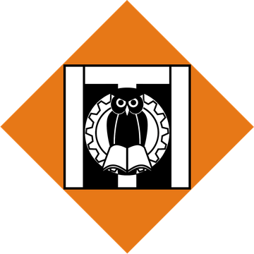
</p>

<h1 align="center">Jar'ecom</h1>

<p align="center">
  <b>Ruang belajar Jaringan Komputer, level demi level.</b><br />
  Aplikasi web progresif (PWA) berbahasa Indonesia: materi bertahap, kuis, XP dan lencana,<br />
  serta Lab Topologi bergaya Cisco Packet Tracer langsung di browser.
</p>

<p align="center">
  <a href="https://jarecom.vercel.app"></a>
  <a href="public/Panduan_Jarecom.pdf"></a>
</p>

<p align="center">
  
  
  
  
  
  
  
  
</p>

<p align="center">
  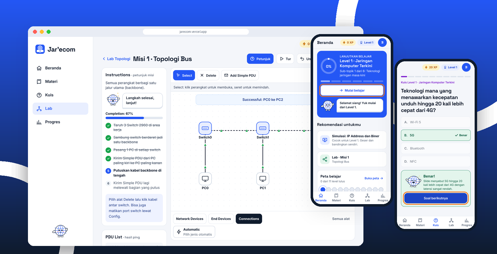
</p>

<p align="center">
  <a href="#tentang">Tentang</a> ·
  <a href="#fitur">Fitur</a> ·
  <a href="#tampilan">Tampilan</a> ·
  <a href="#aturan-belajar">Aturan belajar</a> ·
  <a href="#tim">Tim</a> ·
  <a href="#teknologi-dan-arsitektur">Teknologi</a> ·
  <a href="#menjalankan-di-komputer">Menjalankan</a> ·
  <a href="#struktur-kode">Struktur</a>
</p>

---

## Tentang

Jar'ecom membantu mahasiswa memahami **Jaringan Komputer** dengan cara yang lebih ringan daripada membaca slide: belajar per sub-topik, menjawab cek pemahaman, lalu membuktikan pemahaman lewat kuis dan praktik merakit jaringan sendiri. Materinya mengikuti RPS Jaringan Komputer (IF432103) dan dirangkum menjadi **11 level** yang terbuka berurutan.

Aplikasi dirancang untuk persona **Budi**, mahasiswa Informatika semester awal yang belajar dari HP di sela kuliah: tombol besar, teks yang jelas, umpan balik langsung, dan progres yang tidak hilang.

| | |
| --- | --- |
| **Alamat** | [jarecom.vercel.app](https://jarecom.vercel.app) (bisa dipasang ke layar utama HP dan laptop) |
| **Kampus** | Institut Teknologi Indonesia, Program Studi Teknik Informatika |
| **Mata kuliah** | Interaksi Manusia dan Komputer (IMK), semester Ganjil 2026/2027 |
| **Dosen pengampu** | Melani Indriasari, S.T., M.Kom. (NIDN 0309088101) |
| **Bahasa** | Indonesia (istilah Packet Tracer tetap bahasa Inggris dengan keterangan Indonesia) |
| **Cadangan** | Tag [`v1.0-backup`](../../tree/v1.0-backup) dan [`v2.0-backup`](../../tree/v2.0-backup) |

## Fitur

| Menu | Isi |
| --- | --- |
| **Beranda** | Kartu *Lanjutkan belajar*, rekomendasi, dan peta 11 level. Netty, maskot Jar'ecom, menyapa dan bereaksi. |
| **Materi** | Jalur sub-topik bergaya gim per level, cek pemahaman di setiap sub-topik, diagram untuk topik visual, dan peti fakta jaringan. |
| **Kuis** | 10 soal per level, lulus dengan skor 70. Jawaban diperiksa server dan jawaban pertama langsung terkunci. |
| **Lab** | Tab **Rakit**: 12 misi bergaya Packet Tracer (topologi, kabel, hub vs switch, IP, subnet, router, troubleshooting, proyek kantor). Tab **Simulasi**: 5 gambar interaktif (kabel, OSI vs TCP/IP, hub/switch/router, IP biner, kalkulator subnet). |
| **Progres** | XP, cincin persentase, peta panas 11 level, lencana, dan riwayat XP. |
| **Menu akun** | Profil (kartu pencapaian, tema, ukuran teks, suara, hapus akun), Bantuan, dan Kredit. |

**Yang membuatnya nyaman dipakai**

- **Tur panduan** 8 langkah saat pertama masuk, dan **tur Lab** 5 langkah saat pertama membuka misi. Bisa didengarkan dan diulang.
- **Alat Lab muncul bertahap**: kabel manual dari Misi 7, Hub dan mode Simulation dari Misi 8, Router dari Misi 10. Tombol *Semua alat* tetap tersedia.
- **Progres tidak hilang**: materi melanjutkan dari sub-topik terakhir, pekerjaan Lab tersimpan otomatis per misi, dan keluar di tengah kuis selalu ditanya dulu.
- **Undo dan Ctrl+Z** di Lab, konfirmasi sebelum Reset dan keluar kuis.
- **Mode gelap**, tiga ukuran teks, mode kurangi animasi, dan *Netty diam*.
- **PWA**: bisa dipasang seperti aplikasi biasa dan dibuka saat koneksi putus.
- **Aksesibilitas**: diaudit dengan axe-core di 17 halaman dalam mode terang dan gelap (0 pelanggaran), area sentuh minimal 44 px.

## Tampilan

<table>
  <tr>
    <td align="center">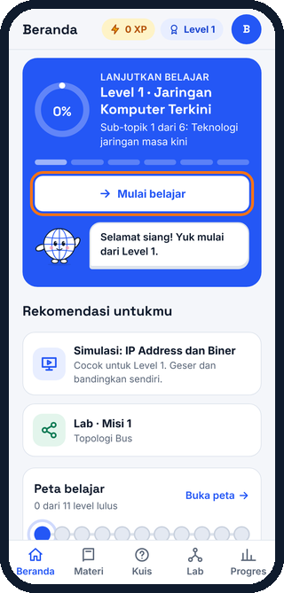<br /><sub><b>Beranda</b></sub></td>
    <td align="center">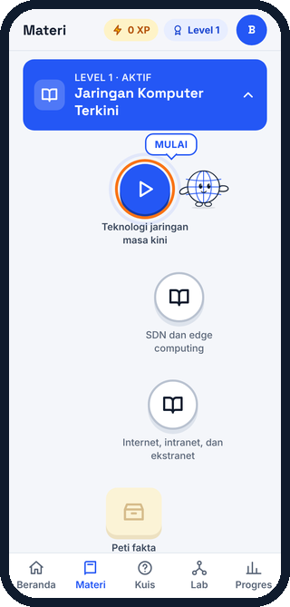<br /><sub><b>Jalur materi</b></sub></td>
    <td align="center">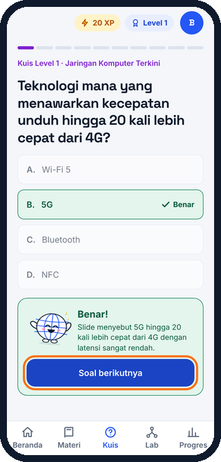<br /><sub><b>Kuis dan umpan balik</b></sub></td>
    <td align="center">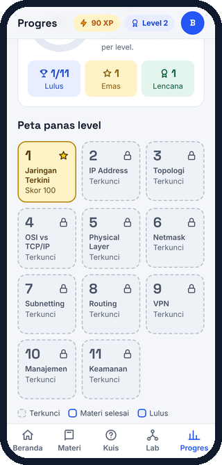<br /><sub><b>Progres dan peta panas</b></sub></td>
  </tr>
  <tr>
    <td align="center">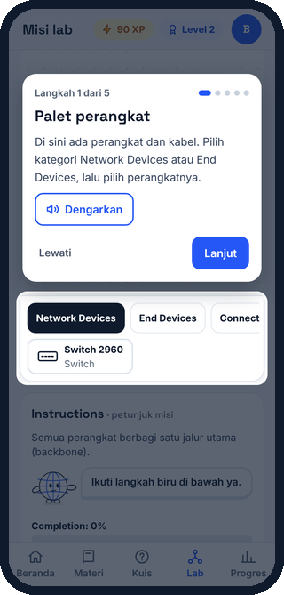<br /><sub><b>Tur Lab</b></sub></td>
    <td align="center">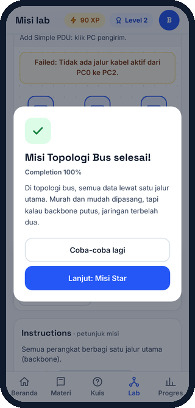<br /><sub><b>Misi Lab selesai</b></sub></td>
    <td align="center">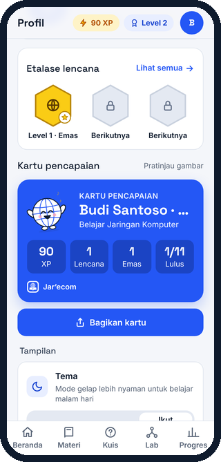<br /><sub><b>Profil dan lencana</b></sub></td>
    <td align="center">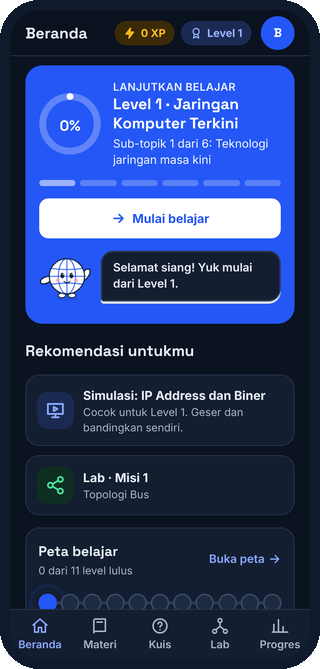<br /><sub><b>Mode gelap</b></sub></td>
  </tr>
</table>

Panduan lengkap bergambar untuk pengguna ada di [`public/Panduan_Jarecom.pdf`](public/Panduan_Jarecom.pdf), juga bisa diunduh dari halaman **Bantuan** di aplikasi.

## Aturan belajar

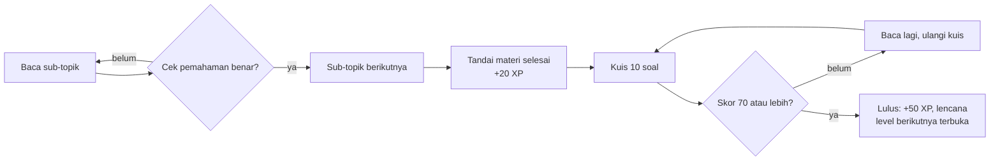

| Hadiah | XP | Keterangan |
| --- | --- | --- |
| Materi satu level selesai | +20 | Sekali per level |
| Kuis lulus (skor 70+) | +50 | Sekali per level, pada kelulusan pertama |
| Skor 100 | +20 | Bonus sekali per level; lencana berubah emas |

Level 1 selalu terbuka. Level berikutnya terbuka setelah materi level sebelumnya selesai **dan** kuisnya lulus. Kuis boleh diulang tanpa batas. Lab adalah latihan dan tidak menambah XP.

## Tim

<table>
  <tr>
    <td align="center" width="25%"><br /><b>Ahmad Rafif Taufiqurrahman</b><br /><sub>1152800016</sub><br />Project Manager</td>
    <td align="center" width="25%"><br /><b>Muhamad Ikbar Tikanto</b><br /><sub>1152800011</sub><br />Programmer</td>
    <td align="center" width="25%"><br /><b>Muhammad Arik Hadi Sucahyo</b><br /><sub>1152800017</sub><br />Analis</td>
    <td align="center" width="25%"><br /><b>Ibrahim Hafid Hatim</b><br /><sub>1152800006</sub><br />Designer</td>
  </tr>
</table>

**Dosen pengampu:** Melani Indriasari, S.T., M.Kom. (Interaksi Manusia dan Komputer) dan Sunarto, S.Kom, M.Kom. (Jaringan Komputer, acuan materi).

Logo Jar'ecom, maskot Netty, ikon, dan suara efek dibuat oleh tim. Sumber materi dan pustaka tercantum di halaman **Kredit** pada aplikasi.

## Teknologi dan arsitektur

| Bagian | Teknologi |
| --- | --- |
| Antarmuka | React 18, TypeScript, Tailwind CSS 3, React Router 7 |
| Build dan PWA | Vite 8, vite-plugin-pwa 2 (Workbox), font self-hosted (@fontsource) |
| Data dan akun | Supabase: Auth email + kata sandi, Postgres dengan RLS dan fungsi RPC |
| Suara | Howler.js, suara efek orisinal (`tools/gen-sfx.py`), suara panduan dari rekaman atau suara perangkat |
| Mutu | Vitest (34 tes), CI GitHub Actions, axe-core, Lighthouse |
| Hosting | Vercel (setiap push ke `main` = deploy produksi) |

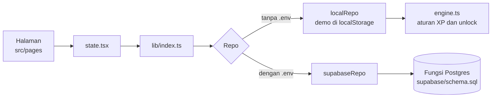

**Keamanan.** Skor, XP, dan unlock dihitung di server (`complete_material`, `submit_quiz`, `get_state`). Tabel progres tidak punya policy tulis, kunci jawaban (`quiz_questions`) tidak bisa dibaca klien, jawaban pertama per soal dikunci di `quiz_answers`, dan saat build dengan Supabase kunci jawaban dibuang dari bundle (`stripQuizKeys` di `vite.config.ts`). Header keamanan (CSP, nosniff, Referrer-Policy, Permissions-Policy) diatur di `vercel.json`. `delete_account()` menghapus akun pemanggil beserta seluruh progresnya.

## Menjalankan di komputer

Prasyarat: **Node.js 22** atau lebih baru (Vite 8 butuh minimal 20.19) dan Git.

```bash
git clone https://github.com/art89557/jarecom.git
cd jarecom
npm install
npm run dev        # http://localhost:5173
```

| Perintah | Fungsi |
| --- | --- |
| `npm run dev` | Server pengembangan |
| `npm test` | 34 tes aturan XP, unlock, dan logika Lab |
| `npm run build` | Build produksi + service worker PWA ke `dist/` |
| `npm run preview` | Mencoba hasil build di http://localhost:4173 |
| `npm run seed:sql` | Membuat ulang `supabase/seed.sql` dari `src/content/level-N.json` |

Tanpa konfigurasi, aplikasi berjalan di **mode lokal**: akun dan progres disimpan di `localStorage` browser. Mode ini hanya untuk demo; kata sandi tidak di-hash.

<details>
<summary><b>Memakai Supabase (produksi)</b></summary>

1. Buat proyek di supabase.com. Di Authentication, pakai Email (kata sandi minimal 8 karakter).
2. SQL Editor: jalankan `supabase/schema.sql`, lalu `supabase/seed.sql`.
3. Salin `.env.example` menjadi `.env`, isi `VITE_SUPABASE_URL` dan `VITE_SUPABASE_ANON_KEY` (Project Settings, API). File `.env` tidak di-commit, dan kunci `service_role` tidak boleh dipakai di frontend.
4. Authentication > URL Configuration: isi Site URL dengan alamat aplikasi dan tambahkan `<alamat>/sandi-baru` ke Redirect URLs.
5. `npm run dev` lagi. Halaman Profil menampilkan "Mode data: Supabase".

Mengubah soal: edit `src/content/level-N.json`, jalankan `npm run seed:sql`, lalu jalankan ulang `supabase/seed.sql`.
</details>

<details>
<summary><b>Deploy</b></summary>

Vercel atau Netlify: build command `npm run build`, output `dist`. Aturan SPA sudah ada (`vercel.json`, `public/_redirects`). Isi dua variabel `VITE_SUPABASE_*` di pengaturan hosting. Di repo ini, setiap push ke `main` otomatis tayang di jarecom.vercel.app dan branch lain mendapat alamat preview.
</details>

## Struktur kode

```
src/
├─ pages/          Auth, Home, MapPage, Material, Quiz, Progress, Profile, Help, Credit, Simulasi
│  └─ lab/         LabList, LabPlay (area kerja), DeviceDialog (Physical, Config, Desktop), parts
├─ components/     Netty, Art (topologi dan diagram), Tour, Confirm, Shell (menu), ErrorBoundary, icons
├─ lib/            engine.ts (aturan), repo + localRepo + supabaseRepo, lab.ts (12 misi), labDraft.ts,
│                  useLeaveGuard.ts, tour.ts, position.ts, prefs.ts, voice.ts
└─ content/        level-1.json sampai level-11.json, kredit.ts
supabase/          schema.sql (tabel, RLS, fungsi), seed.sql
public/            ikon, Netty, suara efek, foto tim, Panduan_Jarecom.pdf
docs/readme/       gambar untuk README ini
```

Aturan kerja untuk pengembang dan Claude Code ada di [`CLAUDE.md`](CLAUDE.md).

<details>
<summary><b>Catatan pengembangan</b></summary>

- Lencana, status node jalur, status kuis, dan warna peta panas diturunkan dari progres (`badgeState`, `nodeState`, `quizStatus`, `heatState` di `engine.ts`), tidak disimpan. Yang disimpan tambahan hanya skor terbaik (`best`) dan riwayat XP (`events`).
- Posisi baca materi tersimpan di perangkat dan disinkronkan ke server (`save_position`). Pekerjaan Lab tersimpan di perangkat saja.
- Suara panduan: taruh rekaman `public/voice/tur-1.mp3` sampai `tur-8.mp3`. Jika tidak ada, aplikasi memakai suara bahasa Indonesia bawaan perangkat. Tur Lab memakai suara perangkat.
- Level 2, 3, 9, dan 10 isinya perlu dicocokkan dengan slide asli (lihat `sumber` di tiap JSON).
</details>

---

<p align="center">
  <br />
  <sub>Dibuat oleh Tim Jar'ecom · Teknik Informatika, Institut Teknologi Indonesia · 2026</sub>
</p>
